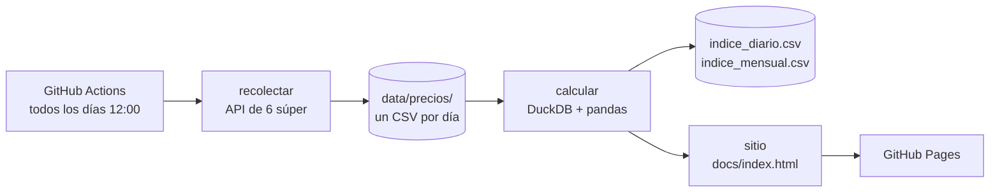

# 🛒 Índice Changuito

[](https://github.com/enri-escaray/indice-changuito/actions/workflows/tests.yml)
[](https://github.com/enri-escaray/indice-changuito/actions/workflows/recolectar.yml)

**Inflación de supermercados en Argentina, medida todos los días con datos abiertos.**

👉 **Sitio:** [enri-escaray.github.io/indice-changuito](https://enri-escaray.github.io/indice-changuito/)

Todos los días a las 12, un robot de GitHub Actions consulta el precio online de 49 productos
en nueve cadenas: Carrefour, Coto, Día, Disco, Jumbo, Más Online y Vea, más Cordiez (Córdoba) y
Toledo (Mar del Plata). Con esos precios calcula un índice
con un método parecido al del IPC y publica un sitio con los gráficos. Todo corre gratis en GitHub,
sin servidores.

Además del índice, el sitio muestra **qué supermercado es más barato** y tiene un **buscador de
productos**. Ahí se busca por nombre, marca o código de barras (sin importar las tildes), se filtra
por categoría o por los que están en promoción, y se ve el precio en cada supermercado. Los filtros
quedan en la URL, así se puede compartir una búsqueda, por ejemplo
[`#q=yerba`](https://enri-escaray.github.io/indice-changuito/#q=yerba).

En el primer relevamiento (19/10/2026), con las promos de ese día, Día salió 10 % más barato que la
mediana, y el mismo producto llegó a costar el doble según la cadena.

## Cómo funciona



- **Fuente:** ocho cadenas usan la plataforma VTEX, que tiene una API pública de catálogo: cada
  producto se busca por su código de barras (EAN), así que en todas se compara exactamente el
  mismo producto. Coto usa otro buscador (Oracle Endeca) que devuelve JSON: ahí se busca por
  nombre y se confirma por el código de barras.
- **Ofertas en Coto:** cuenta solo el descuento directo ("35%Dto"); las promos por cantidad
  ("2do al 70%") y los descuentos con tarjeta se ignoran, igual que en el resto del índice.
- **Datos versionados:** cada día se guarda un CSV en `data/precios/AAAA/MM/`. El historial de
  precios queda en el historial de git (técnica conocida como *git scraping*).
- **Cálculo:** DuckDB lee todos los CSV de una vez y pandas calcula el índice.

## Metodología

1. **Panel de precios de lista:** una fila por día y una columna por (producto, tienda). Si un
   precio falta, se usa el último conocido durante hasta 7 días. El índice usa el **precio
   regular** y no el de promoción. Si no, una promo del 35 % que termina parece una suba del 54 %
   (pasó en Día el 20/10/2026). Las comparaciones entre supermercados sí usan el precio con promo,
   que es lo que se paga.
2. **Variación de cada producto:** media geométrica (Jevons) de la variación diaria en cada tienda.
3. **Índice por categoría:** media geométrica de sus productos, encadenada día a día. La base 100
   es el primer día relevado.
4. **Índice general:** promedio ponderado de las 10 categorías.
5. **Inflación mensual:** promedio del mes contra el promedio del mes anterior, igual que el INDEC.

La canasta y los pesos están en [`canasta.yaml`](canasta.yaml).

## Usarlo en tu compu

```bash
python -m venv .venv
source .venv/bin/activate            # en Windows: .venv\Scripts\activate
pip install -e ".[dev]"

changuito recolectar                 # baja los precios de hoy
changuito calcular                   # recalcula el índice con todo el historial
changuito sitio                      # genera docs/index.html
changuito actualizar                 # los tres pasos juntos

changuito buscar "yerba playadito"   # busca el EAN de un producto para sumarlo a la canasta
pytest                               # corre los tests
```

## Estructura

```
canasta.yaml              productos (por EAN), categorías y pesos
src/changuito/
  fuentes/vtex.py         cliente de la API de las tiendas
  recolectar.py           recolección diaria -> CSV
  indice.py               cálculo del índice, ranking de tiendas y comparación de productos
  sitio.py, plantilla.html  sitio estático con gráficos y buscador (sin dependencias de JS)
data/                     precios crudos e índices calculados
docs/                     sitio que publica GitHub Pages
tests/                    tests de punta a punta, sin internet
```

## Limitaciones (por ahora)

- **Pesos provisorios.** Las ponderaciones de cada categoría son una aproximación propia, no
  las del INDEC.
- **Sin productos frescos.** Carnes, frutas y verduras se venden por peso, y cada cadena les
  pone un código propio. Por eso no se pueden comparar por EAN.
- **Precios online.** Pueden ser distintos a los de la góndola, y no incluyen promociones como
  2x1 ni descuentos bancarios.
- **Promos de Jumbo, Disco y Vea.** Carrefour, Día y Más Online informan el precio regular
  (`ListPrice`). Las cadenas de Cencosud mandan en ese campo el precio sin IVA ×100, así que
  para ellas se usa el precio de venta, y sus promociones pueden colarse en el índice.
- **La serie arranca el 20/10/2026.** El relevamiento del 19/10 no guardó el precio de lista,
  así que solo se usa para las comparaciones de ese día.

## Ideas para seguir

- [ ] Reemplazar los pesos por las ponderaciones del IPC del INDEC.
- [ ] Sumar la base oficial [SEPA / Precios Claros](https://datos.produccion.gob.ar/dataset/sepa-precios),
      que publica a diario 12 millones de precios de todo el país con licencia CC BY 4.0.
- [ ] Comparar el índice con el IPC oficial mes a mes.
- [ ] Agregar carnes, frutas y verduras con un mapeo de códigos por cadena.
- [ ] Publicar los datos también en formato JSON para que otros los usen.

## Licencia

El código tiene licencia [MIT](LICENSE). Los precios son públicos y salen de las tiendas online
de cada cadena.

Las fotos del sitio son de Wikimedia Commons:
- Changuito: [Espumakid](https://commons.wikimedia.org/wiki/File:Carrito_de_supermercado_sobre_se%C3%B1al%C3%A9tica.JPG), CC BY-SA 3.0.
- Supermercado de barrio: [Horacio Cambeiro](https://commons.wikimedia.org/wiki/File:Supermercado_%22Tucangu%C3%A1%22_(Ruiz_de_Montoya).jpg), CC BY 4.0.

Los datos de cada foto están en [`docs/img/creditos.json`](docs/img/creditos.json).
